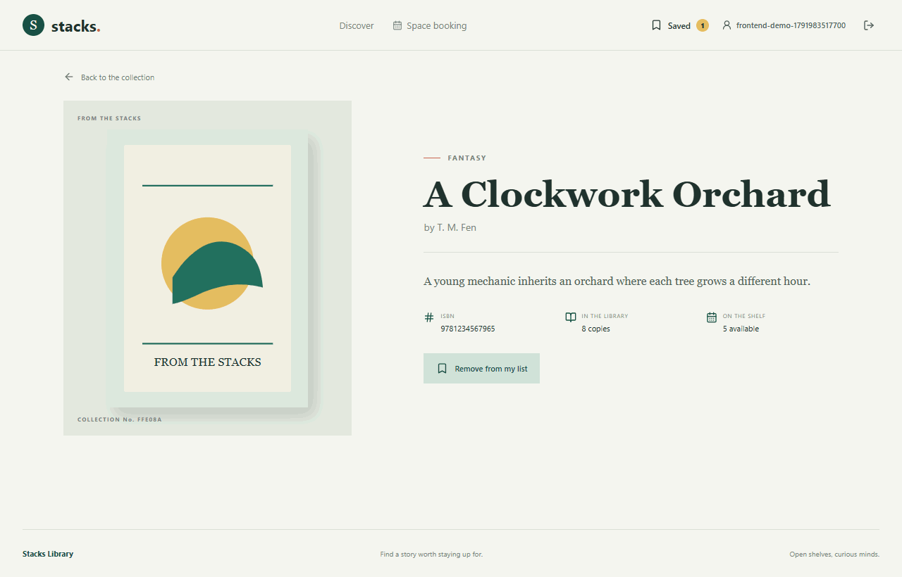

# Library Book Catalog

Mongoose data layer for a library catalog, with separate `Genre` and `Book` collections and a repeatable development seed.

## Setup

Requirements: Node.js with npm and a MongoDB Atlas database (or another MongoDB instance).

1. Install dependencies with `npm install`.
2. Copy `.env.example` to `.env` and replace the placeholders in `MONGODB_URI` with your MongoDB connection details. Use a dedicated development database: the seed removes all existing documents from its `books` and `genres` collections.
3. Run `npm run seed`.

The script inserts five genres and twenty books, then prints a summary. It also ensures one librarian account exists. Set `LIBRARIAN_EMAIL` and a unique `LIBRARIAN_PASSWORD` of at least 12 characters and no more than 72 UTF-8 bytes in `.env`; the password is bcrypt-hashed before storage. The seed removes other librarian-role accounts but leaves patrons intact. It can be run again safely to restore the same catalog. Never commit `.env` or expose its connection string.

## Schema Design

### Genre

`name` is a required, trimmed, unique string used as the display label. `slug` is a required, trimmed, lowercase, URL-safe unique string for stable URLs. Both are stored once in the `genres` collection so books share consistent genre names and slugs; the trade-off is an extra query or populate operation when a book is displayed with genre details.

### Book

| Field | Type and constraints | Storage decision |
| --- | --- | --- |
| `title` | Required trimmed string | Embedded scalar: it belongs to one catalog book and is normally read with the rest of that book. |
| `author` | Required trimmed string | Embedded scalar: keeping the author label on each book makes catalog reads simple; a separate Author collection would add joins and is unnecessary for this assignment's data. |
| `isbn` | Required unique string; accepts ISBN-10/ISBN-13 shapes | Embedded scalar: it identifies this book edition and needs a unique index to prevent duplicate catalog entries. |
| `description` | Required trimmed string | Embedded scalar: book-specific descriptive text is read with the book and is not shared independently. |
| `coverImage` | Required URL string | Embedded scalar: the URL is a property of this book's cover and avoids another lookup. |
| `totalCopies` | Required whole number, minimum 1 | Embedded scalar: this inventory count belongs to this catalog record and is read together with availability. |
| `availableCopies` | Required whole number, minimum 0, no greater than `totalCopies` | Embedded scalar: it is book inventory state. Keeping both counts together simplifies checks, though concurrent checkout workflows would later need atomic updates to avoid stale counts. |
| `genre` | Required `ObjectId`, `ref: 'Genre'` | Reference, not an embedded genre object: many books can share a genre without duplicating its name/slug. This improves consistency at the cost of a populate or second query. |

The seed creates genre documents first, maps their slugs to MongoDB `_id` values, and inserts those IDs into each book's `genre` field. Seeded ISBN-13 check digits are valid, ISBN values are unique, and no seeded `availableCopies` value exceeds its `totalCopies`.

## Submission Evidence

After running the seed against Atlas, capture the `books` collection with at least 15 documents and the `genres` collection with at least four documents. Submit those genuine Atlas screenshots and this repository's URL through the course portal.

This repository's `screenshots/` directory currently contains locally captured collection views from `localhost:27017` to verify the seed output. They are not Atlas screenshots and do not replace the Atlas evidence required above.

## Catalog API

The Express API uses the same Mongoose models and `MONGODB_URI` as the seed script. Install dependencies with `npm install`, configure `.env`, seed the database if needed with `npm run seed`, and start the service with `npm start`. The default address is `http://localhost:3000`; set `PORT` to override it. `GET /health` returns a small health status.

### Book endpoints

| Method | Endpoint | Success |
| --- | --- | --- |
| `GET` | `/books` | `200`; `{ data, pagination }` |
| `GET` | `/books/:id` | `200`; one book, or `404` if absent |
| `POST` | `/books` | `201`; created book |
| `PUT` | `/books/:id` | `200`; updated book, or `404` if absent |
| `DELETE` | `/books/:id` | `204`; `404` if absent |

`GET /books` accepts `genre=<genre ObjectId>`, `search=<text>`, `page=<positive integer>`, and `limit=<1..100>`. The filters compose, and search is case-insensitive across title and author. Results are sorted by title and then ID for stable paging. For example: `GET /books?genre=<genreId>&search=dune&page=2&limit=5`. The response contains `data` and `pagination` fields (`page`, `limit`, `total`, and `totalPages`). Invalid IDs, unknown genres, and invalid page values return `400` JSON.

### Genre endpoints

| Method | Endpoint | Success |
| --- | --- | --- |
| `GET` | `/genres` | `200`; list of genres |
| `GET` | `/genres/:id` | `200`; one genre, or `404` if absent |
| `POST` | `/genres` | `201`; created genre |
| `PUT` | `/genres/:id` | `200`; updated genre, or `404` if absent |
| `DELETE` | `/genres/:id` | `204` when deleted; `409` if books still reference it; `404` if absent |

Genre deletion is restricted while any book references that genre. This avoids orphaned book references and asks the caller to reassign or delete those books first.

### Validation and errors

Book and genre create/update routes validate required fields, JSON types, and schema constraints before writing. Book validation also confirms the referenced genre exists. Validation failures, including duplicate unique values, return `400` with `{ "error": "Validation failed", "fields": [{ "field": "...", "message": "..." }] }`. Invalid ObjectId route parameters return `400`; unknown resources return `404`; unexpected failures return generic JSON without stack traces or raw database error details.

### Postman and tests

Import [`postman/library-catalog.postman_collection.json`](postman/library-catalog.postman_collection.json) into Postman. Set `baseUrl`, `librarianEmail`, and `librarianPassword`; run login and copy its returned token to `librarianToken`. Replace `genreId` and `bookId` with IDs from your database. The collection includes auth/profile/logout, all book/genre endpoints, combined filtering, and a saved empty-body `400` validation example.

Run `npm test` to execute the integration suite. Tests use `TEST_MONGODB_URI` when set, otherwise the isolated local database `library_catalog_api_test`; the suite clears the `books`, `genres`, `users`, and `sessions` collections in that test database before and after running.

## Authentication and Authorization

The API adds `POST /api/auth/register`, `POST /api/auth/login`, `POST /api/auth/logout`, and `GET /api/users/profile`. Registration always creates a `patron`, even if a client includes a `role` property. The seed creates exactly one librarian from the environment credentials; do not hard-code the librarian password. Login returns a short-lived opaque bearer token and sets the same token in an `HttpOnly`, `SameSite=Strict` cookie. Passwords use bcrypt with a work factor of 12 and are limited to 72 UTF-8 bytes to avoid bcrypt input truncation. MongoDB stores only each password's bcrypt hash and a SHA-256 digest of each session token, never the plaintext password or reusable token.

Book `POST`, `PUT`, and `DELETE` require a valid session and the `librarian` role. Missing or invalid tokens receive `401`; a valid patron token receives `403`. The profile endpoint derives identity from the verified session and returns only that user's ID, email, role, and creation time; query/body user IDs are ignored.

### Token Storage Write-up

Browser clients use an `HttpOnly`, `SameSite=Strict` cookie so JavaScript cannot read the session token, reducing the impact of an XSS bug stealing credentials. Cookies introduce CSRF considerations, so this service uses `SameSite=Strict`; a production deployment that adds cross-site workflows should also enforce trusted origins and a CSRF-token strategy. The cookie is marked `Secure` in production (or when `AUTH_COOKIE_SECURE=true`); local HTTP development leaves it unset. For non-browser clients such as Postman, login also returns the opaque token in JSON for an `Authorization: Bearer` header; those clients must keep it in a protected secret store and out of logs and source control.

Rather than trusting a self-contained JWT until expiry, each opaque token is backed by a server-side session record. MongoDB stores only its SHA-256 digest, and the record expires after 24 hours. Logout deletes that record and clears the cookie, so the same token is rejected immediately whether it came from a cookie or bearer header. This provides reliable server-side revocation and avoids storing reusable tokens in the database, at the cost of a session-store lookup on each authenticated request and dependence on database availability. A localStorage token would be simpler for a browser SPA, but a successful XSS could read and exfiltrate it; this design accepts the lookup cost to reduce that exposure and make logout genuinely invalidate sessions.

Configure `.env` including the librarian variables, run `npm install`, `npm run seed`, then `npm start`. The Postman collection includes registration, login, profile, logout, and librarian-protected book mutations. `npm test` covers anonymous `401`, patron `403`, librarian success, bcrypt password hashing, caller-only profile data, and session revocation.

## Library Catalog Frontend

The patron-facing React app lives in [`client/`](client/). It uses Vite, React Router, and the existing Express API. From the repository root, start the API with `npm start` after configuring `.env` and seeding data. In a second terminal, run `cd client`, `npm install`, then `npm run dev`; open the local URL printed by Vite. The Vite development proxy forwards `/books`, `/genres`, and `/api` to `http://127.0.0.1:3000`, so no browser CORS configuration is needed. For a production deployment, serve the built `client/dist/` assets behind the API or set the same-origin API reverse proxy.

The catalog uses server-side filtering through `GET /books?genre=&search=&page=&limit=` rather than downloading the full collection. This keeps search, genre, and pagination combinable in one request and limits data transferred to the browser. Search waits 400 ms after typing before changing the query; filters stay in the URL, and the responsive grid reflows from two cards on small screens to four on wide screens. Catalog and detail views each render visible loading, error, and empty/not-found states. Cover images fall back to a local illustration if remote artwork is unavailable. Detail pages use `/book/:id` in the client because `/books/:id` is reserved for the proxied API route.

### Frontend Demo

The recorded walkthrough is committed at [`client/public/demo.gif`](client/public/demo.gif). It demonstrates browsing the catalog, narrowing by genre, searching, and opening a book detail page.

